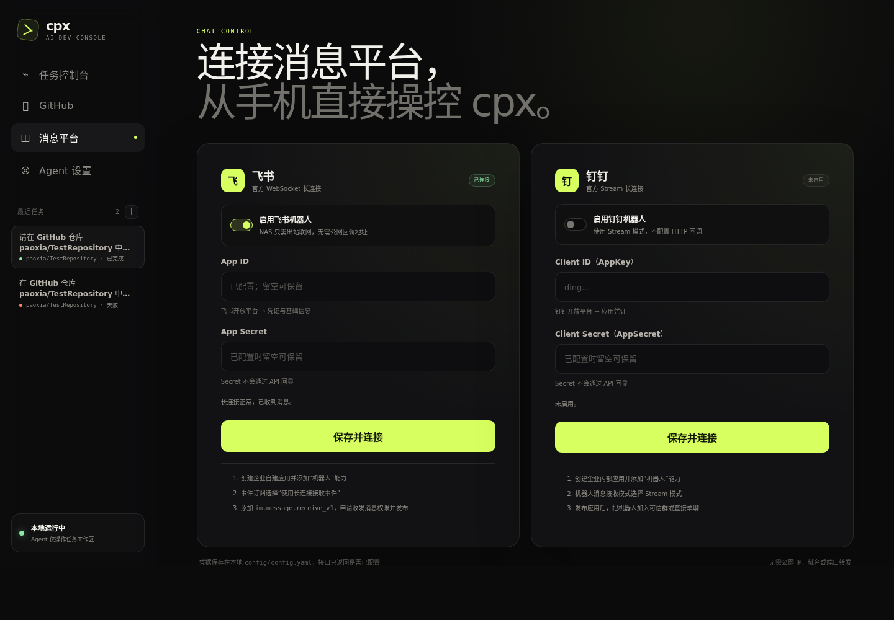
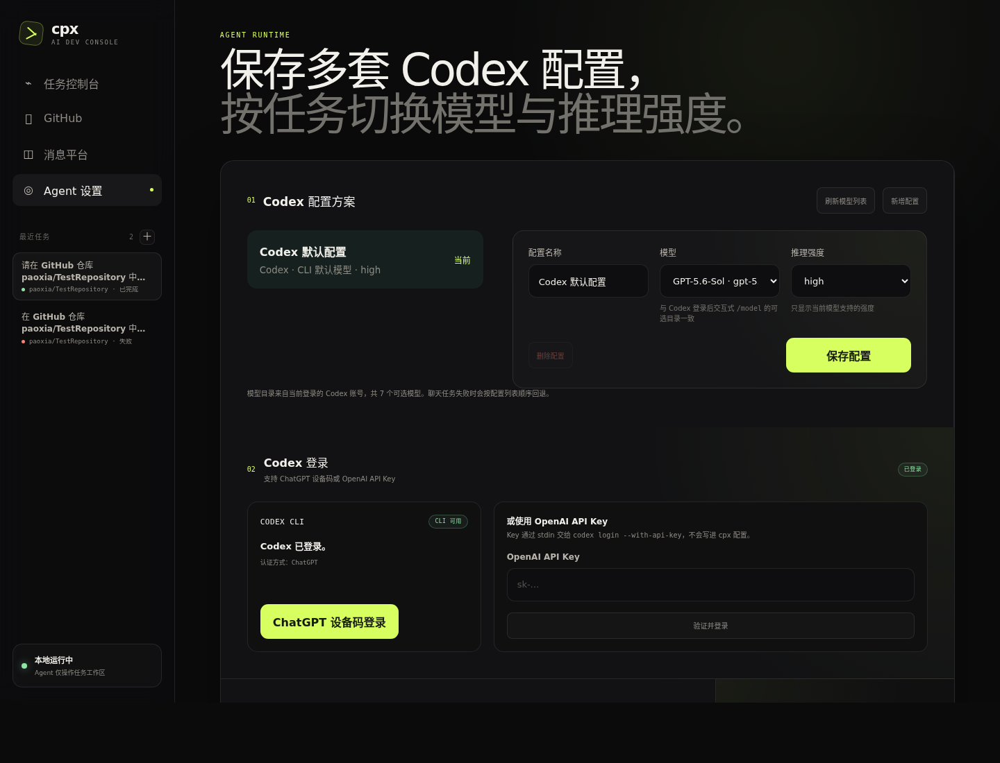

# cpx

<p align="center">
  <strong>把 NAS 变成一个可从浏览器、飞书和钉钉随时调用的 AI 开发工作站。</strong><br />
  <em>Turn your NAS into an AI development workstation controlled from the web, Feishu, or DingTalk.</em>
</p>

## 中文介绍

cpx 是一个面向个人开发者和小团队的自托管 AI 开发控制台。它把 Codex、GitHub、飞书与钉钉连接在同一个工作流中：你可以在浏览器或手机聊天里提交开发需求，cpx 会创建隔离的 Git 工作区，调用 Codex 完成修改，并按需推送分支、创建 Pull Request。

飞书和钉钉使用官方 WebSocket/Stream 长连接，NAS 只需能够出站访问网络，不需要公网 IP、HTTP 回调或固定群机器人 Webhook。Codex 可直接在页面登录；页面读取登录账号在 Codex `/model` 中看到的同一模型目录，并可把模型与其支持的推理强度保存为多套配置。项目专门提供不依赖 SSH 的极空间 Docker 部署与更新流程。

## English introduction

cpx is a self-hosted AI development console for individual developers and small teams. It brings Codex, GitHub, Feishu, and DingTalk into one workflow: submit a coding request from the browser or your phone, let cpx create an isolated Git workspace and run Codex, then optionally push a branch and open a Pull Request.

Feishu and DingTalk use their official WebSocket/Stream connections, so your NAS only needs outbound network access—no public IP, inbound HTTP callback, or fixed group webhook. Codex can be authenticated from the web console. The model selector uses the same account-specific catalog shown by Codex `/model`, and each profile only offers reasoning levels supported by its model. A no-SSH Docker workflow is included for ZSpace (极空间) NAS deployment and upgrades.

## 页面预览 / Screenshots

### 飞书与钉钉长连接 / Feishu and DingTalk connections



### Codex 登录与多套模型配置 / Codex authentication and profiles



## 功能特性

- **钉钉/飞书远程控制** - 使用官方 WebSocket/Stream 长连接收发机器人消息，无需公网回调
- **Skill 插件系统** - 从 npm/local/git 安装插件，动态加载执行
- **MCP 连接器** - 支持 stdio/websocket/http 三种传输协议连接外部 MCP 服务
- **GitHub 远程操作** - 读取、修改、创建文件并自动创建 PR
- **Codex 开发控制台** - 以任务会话管理隔离工作区，可在同一任务中持续追加要求
- **账号模型目录** - 登录后读取与 Codex `/model` 相同的模型列表，并按模型联动推理强度
- **多套模型配置** - 保存配置名称、模型与推理强度，一键切换当前方案
- **权限控制** - 主分支保护、危险操作二次确认、操作审计日志
- **命令中英双语** - 支持中文和英文命令（如 `修改` / `modify`）

## 环境要求

- Node.js >= 18.0
- npm >= 8.0

## 快速开始

正式发布到 npm 后，先安装 Codex CLI，再安装 cpx：

```bash
npm install -g @openai/codex @paoxia/cpx
cpx config
cpx doctor
cpx start --daemon
```

浏览器访问 `http://localhost:3000/`。使用 `cpx status` 查看状态，使用 `cpx stop` 精准停止由当前 `CPX_HOME` 启动的实例。npm 安装默认把配置、数据库、日志和 PID 分别保存在 `~/.cpx/config`、`~/.cpx/data`、`~/.cpx/logs` 和 `~/.cpx/run`；可通过 `CPX_HOME` 或全局 `--home <目录>` 覆盖。相对运行路径始终相对于配置目录的父目录解析，不依赖执行命令时所在的工作目录。

从源码开发时使用：

```bash
# 安装依赖
npm install

# 初始化配置文件
npm run dev -- init -d ./config

# 编辑配置，填写钉钉/飞书应用凭据、GitHub Token 等；也可启动后在页面填写
# 编辑 config/config.yaml 和 config/permissions.yaml

# 启动系统
npm run dev -- start -d ./config
```

启动后通过 HTTP 接口发送命令测试：

```bash
curl -X POST http://localhost:3000/command \
  -H "Content-Type: application/json" \
  -d '{"text":"version","userId":"u1","userName":"Tester","source":"cli"}'
```

浏览器访问 `http://localhost:3000/` 可打开 AI 开发控制台。运行控制台任务还需要：

- 本机已安装 `codex` CLI；可在页面使用 ChatGPT 设备码或 OpenAI API Key 登录。
- 本机已安装 Git，且能访问目标 GitHub 仓库。
- 通过飞书或钉钉发布 Pull Request 时还需安装 GitHub CLI（`gh`），并为 Token 配置推送分支和创建 PR 的权限。

控制台的 GitHub 页签在没有 Token 时提供“创建 GitHub Token”入口，打开 GitHub 的 fine-grained PAT 页面并预填 90 天有效期及 Contents、Pull requests、Workflows 写权限；用户仍需在 GitHub 选择资源所有者和仓库，生成后复制回控制台验证。新输入的 Token 仅在验证成功后写入 `config/config.yaml`；若 `github.token` 或 `AGENT_GITHUB_TOKEN` 已配置，可以留空直接验证，且不会将环境变量 Token 复制到配置文件。页面会区分本地文件与环境变量来源，受限 Token 只显示明确授权的仓库。

验证成功的 Token 同时供 GitHub API、HTTPS `git clone/fetch/push` 和 `gh pr create` 使用。Token 仅通过子进程环境和 askpass helper 传递，不会拼入 Git URL 或任务日志；SSH 仓库仍使用部署环境中的 SSH Key。GitHub 页提供仓库筛选与仓库主页链接。

“Agent 设置”页管理 Codex 登录并保存多套执行方案。每套方案包含名称、模型和推理强度；模型来自当前登录账号在 Codex `/model` 中使用的同一目录，推理强度只显示该模型支持的值。设为“当前”的方案供 Web 任务使用，聊天任务在额度或鉴权失败时会按列表顺序尝试其余方案。Codex 的审批策略、沙箱模式和网页搜索写入 `CODEX_HOME/config.toml`。登录密钥不写入模型方案；页面还可用当前方案发送最多 4000 字的内容进行真实连通性测试。

### 在远程服务器连接 Codex

浏览器打开 cpx 的“Agent 设置”，在 Codex 区域点击“ChatGPT 设备码登录”，然后：

1. 在任意可信浏览器打开验证地址。
2. 登录拥有 Codex 权限的 ChatGPT 账号并输入设备码。
3. 返回页面等待状态变为“已连接”，再使用页面测试。

Codex CLI 将凭据保存在运行 cpx 的系统用户凭据目录，不写入 `console-settings.json`。也可在页面填写 OpenAI API Key；cpx 不直接持有 OAuth refresh token。参见 [Codex Authentication](https://learn.chatgpt.com/docs/auth)。

三端均可运行，但 cpx 服务必须与完成登录的 CLI 使用同一系统用户：

| 平台    | 支持方式                | 注意事项                                                                             |
| ------- | ----------------------- | ------------------------------------------------------------------------------------ |
| Linux   | 原生 Node.js / Docker   | CLI 必须在 `PATH`；服务用户的 HOME 可写。Docker 已持久化 `/root/.codex`。            |
| macOS   | 原生 Node.js            | Codex 可使用系统钥匙串或 `~/.codex`；后台服务必须以完成授权的用户运行。              |
| Windows | 原生 PowerShell，或 WSL | cpx 会通过 shell 解析 npm 的 `.cmd` 包装脚本；不要混用 Windows 与 WSL 的 HOME/凭据。 |

不要在一个系统用户下授权、再让另一个服务账户运行 cpx，否则状态检查会显示未登录。

> 控制台设置 API 没有通用身份认证。默认配置监听 `0.0.0.0`，请通过防火墙或带认证的反向代理限制访问。[安全说明](docs/SECURITY.md#http-端点)

## digital-avatar 工作区

控制台侧栏的「工作区」支持打开已有目录、新建本地工作区、通过通用 Git 地址克隆根仓库，以及登记本地或远端子项目。页面填写 cpx 服务所在机器的绝对路径。在本机调试时，使用 `AGENT_SERVER_HOST=127.0.0.1 cpx start` 启动，并直接通过 `http://127.0.0.1:3000` 打开。通过 HTTPS 代理访问部署实例时，在服务端设置至少 32 字符的随机 `AGENT_WORKSPACE_WEB_TOKEN`，进入页面时填写该令牌。页面使用运行 cpx 的系统用户所配置的 Git 凭据。

Docker 部署时，在 Compose 项目环境变量中设置工作区令牌。页面路径使用容器内路径，持久化工作区可以放在已挂载的 `/app/data/` 内。

选择「读取 GitHub 工作区」，可输入 `owner/repo` 或 GitHub 仓库主页，也可从已连接账号的授权仓库中选择。cpx 实时读取 `main` 上的项目清单和 Story。私有仓库使用 GitHub 页已连接的凭据。

首页是「会话工作台」。左侧可在「会话」和「目录结构」之间切换。在「目录结构」中展开 `code/`、`story/` 或 `archive/`，点击文件在右侧预览。预览支持不超过 1 MiB 的文本、PNG、JPEG、GIF 和 WebP，适用于本地和 GitHub 工作区。切回「会话」即可继续当前对话和草稿。

打开本地工作区后，在输入框描述想法，cpx 调用 Codex 命名、用初始需求创建 `story/YYYY-MM-DD-需求名/说明.md` 并执行。页面显示对话和执行状态，运行日志按需展开。会话列表显示当前工作区已绑定 Codex 线程的会话，支持搜索。按 Enter 发送，按 Shift+Enter 换行。cpx 将后续消息、回复和绑定的 Codex 线程 ID 保存在工作区本地会话数据库中。cpx 重启后，重新打开会话即可查看历史，并使用同一份 Codex 数据继续原线程。

仅监听本机回环地址时，可设置 `AGENT_WORKSPACE_DEFAULT_ROOT` 为本地 `digital-avatar` 的绝对路径，打开首页即可使用该工作区。

`cpx workspace` 提供同样能力的 CLI 入口：

```bash
cpx workspace init ./my-workspace
cpx workspace show ./my-workspace
cpx workspace clone git@gitee.com:owner/workspace.git ./work-copy
cpx workspace add notes git@gitee.com:owner/notes.git --root ./my-workspace --purpose 知识笔记
```

新工作区从 `main` 开始，包含 `README.md`、`AGENTS.md`、`repos.txt`、`code/`、`story/` 和 `archive/`。初始化和克隆接受空目录或其父目录下尚未存在的路径。已有工作区在 `main` 时可以直接查看，`show --json` 可列出本地项目和待克隆的项目。登记已放在 `code/<项目名>/` 下的独立 Git 仓库时，可省略克隆地址。

项目登记更新根仓库的项目导航和远端清单，Git 克隆使用本机的 SSH 凭据或 Git 凭据助手。根仓库的模板与登记记录作为本地文件供用户检查、提交和推送。会话工作台使用服务所在机器的 Codex 登录和模型配置。

## 极空间 Docker 部署

极空间 NAS 不需要开启 SSH。部署、更新和查看日志都通过极空间文件管理器与 Docker Compose 图形界面完成。可直接上传源代码构建，也可在开发机离线构建镜像后导入。详见 [docs/DEPLOYMENT.md](docs/DEPLOYMENT.md)。

源码部署快速步骤：

1. 在电脑获取仓库源码，把完整 `cpx` 文件夹上传到 NAS 持久化目录
2. 在极空间文件管理器中创建 `data/codex`、`data/repositories`、`data/workspaces` 和 `logs` 子目录
3. 打开“Docker → Compose → 新建项目”，项目存储位置选择上传后的 `cpx` 目录
4. 导入或粘贴根目录 `docker-compose.yml`，确认后由极空间自动构建并启动
5. 浏览器访问 `http://<NAS-IP>:3000`，在控制台连接 GitHub、Codex 和所需消息平台

更新已经运行的实例时，先在极空间 Compose 页面停止项目并备份 `data`、`config`、`logs`；在电脑取得新源码后，通过极空间文件管理器覆盖程序文件，但绝不能覆盖或删除这三个持久化目录。由于本版本把消息平台切换为纯长连接，还需要在 Compose 编辑器中同步新版 `docker-compose.yml`，再选择“重新构建并重新创建”并查看健康状态与日志。不要选择“删除数据卷”。NAS 无法稳定访问软件源或资源有限时，可在开发机构建并导出镜像，通过极空间镜像页面导入后修改镜像标签、重新创建容器。完整步骤见 [更新已运行实例](docs/DEPLOYMENT.md#十更新)。

从旧消息配置升级后，在页面重新填写钉钉 Client ID/Client Secret 或飞书 App ID/App Secret；旧的 HTTP 回调地址、签名 Secret 和固定群 Webhook 环境变量不再使用。已有 `data/codex` 会继续保留 Codex 登录。

Codex CLI 不需要在 NAS 上单独安装。`Dockerfile` 会安装 `@openai/codex`，离线镜像包也包含它。容器启动后进入“Agent 设置”完成登录、刷新账号模型目录、保存多套配置并测试。认证资料通过 `./data/codex:/root/.codex` 持久化，重新构建容器不会主动删除。

NAS 网络不能直接连接 Codex 或构建软件源时，在极空间 Compose 环境变量界面配置 `HTTP_PROXY`、`HTTPS_PROXY`、`ALL_PROXY` 和 `NO_PROXY`。代理地址必须使用容器可访问的局域网 IP，不能使用 `127.0.0.1`；基础镜像无法拉取时改用开发机构建、极空间图形界面导入镜像的方案。具体填写方式和构建/运行阶段的区别见 [部署文档的“出站代理”章节](docs/DEPLOYMENT.md#出站代理)。

镜像构建阶段可通过 `APT_MIRROR` 选择 Debian 软件源，通过 `NPM_REGISTRY` 选择 npm 源。国内开发机可分别设置为 `http://mirrors.aliyun.com` 和 `https://registry.npmmirror.com`。这两个变量只影响构建中的依赖下载，不改变运行中 Agent 的模型服务地址。

如果已有合法可用的 Clash/Mihomo 配置，也可以导入预构建镜像并使用 [docker-compose.mihomo.yml](docker-compose.mihomo.yml)，让同一 Compose 项目中的 cpx 通过 Mihomo `mixed-port` 出站。项目提供可定时更新订阅的 [Mihomo 配置示例](config/mihomo.example.yaml)。该方案不使用 TUN、特权容器或 NAS 终端；实际配置保存在 `data/mihomo` 且不会提交到 Git。首次部署见 [部署文档的“NAS 内置 Mihomo 容器”章节](docs/DEPLOYMENT.md#nas-内置-mihomo-容器)，日常试运行当前代码见 [NAS 开发调试指南](docs/NAS-DEBUGGING.md)。

## CLI 命令

```bash
cpx config                         # 交互配置
cpx config init                    # 在 ~/.cpx 初始化模板
cpx config show                    # 显示脱敏后的合并配置
cpx config get server.port         # 读取配置
cpx config set server.port 3001    # 写入并校验配置
printf '%s' "$GITHUB_TOKEN" | cpx config set github.token --stdin
cpx config validate                # 校验配置
cpx doctor                         # 检查 Node.js、Git、Codex 与配置
cpx start                          # 前台启动
cpx start --daemon                 # 后台启动
cpx status                         # 进程状态与 HTTP 健康检查
cpx stop                           # 按 PID 优雅停止当前实例
cpx update                         # 检查 npm 新版本
```

`agent-cli` 与 `cpx init -d <目录>` 作为旧版兼容入口继续保留。Docker 仍显式执行 `cpx start -d /app/config`，不会迁移已有 `/app/config` 和 `/app/data`。开发模式下使用 `npm run dev -- <command>`；要沿用仓库内配置，可传 `-d ./config`。

敏感配置键（如 `token`、`secret`、`password`）拒绝直接写在命令参数中，必须经 `--stdin` 传递，避免进入 shell 历史。`cpx config show` 和 `get` 会自动隐藏敏感值。发布 npm 包时只包含示例 YAML，不包含本地 `config.yaml`、数据库或日志。

## 飞书与钉钉自然语言操作

### 继续会话工作台的会话

在「消息平台」启用需要的机器人，然后在机器人聊天中发送 `/whoami`，取得该平台的用户 ID。在 cpx 的 `config.yaml` 中补充以下字段，保留原有的应用凭据和启用状态。Docker 部署使用容器内的工作区路径。已经设置 `AGENT_WORKSPACE_DEFAULT_ROOT` 的实例可以沿用它作为工作区路径。

```yaml
messagingWorkspaceRoot: "/path/to/digital-avatar"
dingtalk:
  workspaceUsers: ["钉钉机器人返回的用户 ID"]
feishu:
  workspaceUsers: ["飞书机器人返回的用户 ID"]
```

钉钉、飞书与网页共用该工作区的会话列表和 Codex 线程。在群聊中 @机器人，或直接私聊机器人。每个账号在每个聊天里可以单独选定当前会话。直接发送文本会继续所选会话，首次发消息会创建会话。完成后机器人在原聊天回复，网页会话中保留完整回复。

| 命令 | 用途 |
| --- | --- |
| `/new [想法]` | 创建会话。省略想法时，下一条文本创建会话 |
| `/sessions [页码]` | 分页查看工作区所有会话及 ID，包括网页创建的会话 |
| `/switch <会话 ID>` | 切换当前会话，之后的文本进入该会话 |
| `/resume <会话 ID> [消息]` | 恢复会话，可在同一条命令里发出下一轮消息 |
| `/whoami` | 查看自己的平台用户 ID |
| `/help` | 查看命令 |

也可以用「新建会话」「查询所有会话」「切换会话」「继续会话」。工作区正在执行时，机器人会提示等待当前轮次结束。

### GitHub 任务入口

使用独立 GitHub 任务流程的部署可以省略工作区根路径配置。

在钉钉或飞书群中 @机器人，或直接私聊机器人，然后像和开发同事交流一样描述目标。无需先学习仓库、分支、任务或 MCP 的固定命令；飞书私聊仍可使用可选的 `/agent` 前缀。

```text
帮我看看 GitHub 里有哪些项目
在 cpx 项目修复飞书消息重复回复的问题，补充测试，完成后创建 PR
就用刚才提到的第一个仓库，从 main 分支开始
把按钮改成蓝色，再检查一下移动端布局
查询刚才任务的状态
停止正在执行的任务
```

当前会话没有开发任务时，cpx 会启动一个不绑定仓库的只读协调 Codex。它可以通过受限的 `cpx_platform` MCP 工具查询当前 Token 可访问的 GitHub 仓库和分支；仓库不明确时会自然追问，明确后再创建隔离 worktree 任务。任务创建后，后续文本进入该任务的同一个 Codex `thread_id`，继续使用原工作区和任务分支。

Codex 还可通过同一组受限工具查询、继续或停止当前用户的任务，并向发起消息的原会话发送阶段性进度。工具目标由 cpx 锁定为当前平台、用户和会话，不能由 Codex 更换。代码任务完成后，cpx 自动回传最终回答、状态和 PR 链接。同一任务正在执行时不会并行接受下一轮。

### 少量控制入口

自然语言是默认入口；以下命令只用于需要立即、确定地控制会话时：

| 命令                | 说明                                  |
| ------------------- | ------------------------------------- |
| `/new`              | 脱离当前任务，开始新的协调 Codex 对话 |
| `/tasks [数量]`     | 列出当前用户最近的任务                |
| `/status [任务ID]`  | 查看指定任务；省略 ID 时查看最近任务  |
| `/stop [任务ID]`    | 停止指定任务；省略 ID 时停止最近任务  |
| `/help`             | 显示帮助                              |
| `/confirm <确认ID>` | 确认需要显式授权的高风险操作          |
| `/cancel <确认ID>`  | 拒绝待确认操作                        |

原有的 `开发 owner/repo ...`、`查看GitHub`、`继续 <ID> ...` 等文本命令仍保留兼容性，主要用于 HTTP `/command` 调试或旧客户端；新的飞书、钉钉使用流程不依赖这些格式。聊天任务只能由创建它的同一平台、同一用户管理。协调会话、任务归属、状态和日志均保存在进程内，服务重启后不会恢复。

## 配置

配置文件位于 `config/` 目录，优先级从低到高：默认配置 < config.yaml < permissions.yaml < 环境变量。

### config.yaml

```yaml
server:
  port: 3000
  host: 0.0.0.0

dingtalk:
  enabled: false
  clientId: '' # Client ID / AppKey
  clientSecret: '' # Client Secret / AppSecret

feishu:
  enabled: false
  appId: ''
  appSecret: ''

github:
  token: '' # ghp_xxx Personal Access Token
  defaultRepo: '' # owner/repo 默认仓库
  defaultBranch: main

skills:
  installPath: ./data/skills
  executionTimeout: 30000 # 毫秒

mcp:
  connections: []
  # stdio 传输（本地子进程）
  # - name: filesystem
  #   transport: stdio
  #   command: npx
  #   args: ["-y", "@modelcontextprotocol/server-filesystem", "/tmp"]
  # websocket 传输
  # - name: remote-ws
  #   transport: websocket
  #   url: ws://localhost:3001
  # http 传输
  # - name: remote-http
  #   transport: http
  #   url: http://localhost:3002/mcp

logging:
  level: info # debug | info | warn | error
  file: ./logs/agent.log

storage:
  path: ./data/agent.db
```

### permissions.yaml

```yaml
git:
  protectedBranches: [main, master, production]
  allowedBranches: [feature/*, dev/*, hotfix/*]
  forbiddenOperations: [force_push, delete_branch, delete_repository]
  confirmOperations: [delete_file, merge_to_main]

operations:
  blacklist: []

confirmationTtl: 300 # 确认超时秒数
```

### 环境变量

环境变量以 `AGENT_` 前缀覆盖配置文件，适合 Docker 部署：

```bash
AGENT_SERVER_PORT=3000
AGENT_DINGTALK_ENABLED=true
AGENT_DINGTALK_CLIENT_ID=dingxxx
AGENT_DINGTALK_CLIENT_SECRET=xxx
AGENT_FEISHU_ENABLED=true
AGENT_FEISHU_APP_ID=cli_xxx
AGENT_FEISHU_APP_SECRET=xxx
AGENT_GITHUB_TOKEN=ghp_xxx
AGENT_GITHUB_DEFAULT_REPO=owner/repo
AGENT_LOGGING_LEVEL=info
AGENT_STORAGE_PATH=./data/agent.db
```

Codex 可使用 `CODEX_API_KEY`，也可直接在页面完成官方 CLI 登录；认证信息由 CLI 管理，模型方案不保存 API Key。

## HTTP API

### GET /

返回 AI 开发控制台。控制台使用以下 API：

| 端点                                         | 说明                                           |
| -------------------------------------------- | ---------------------------------------------- |
| `POST /api/console/model-test`               | 向 Codex 发送内容并返回文本回复                |
| `GET/POST /api/console/settings`             | 读取或保存多套 Codex 配置和当前配置            |
| `GET /api/console/agent-auth?provider=codex` | 检查 Codex CLI 登录状态                        |
| `POST /api/console/agent-auth/login`         | 启动 Codex 设备码登录                          |
| `POST /api/console/agent-auth/api-key`       | 通过标准输入将 API Key 交给 Codex CLI          |
| `POST /api/console/agent-auth/cancel`        | 取消进行中的 Codex 登录                        |
| `GET /api/console/codex-models`              | 读取当前账号在 Codex `/model` 使用的模型目录   |
| `GET/POST /api/console/codex-config`         | 读取或保存 `CODEX_HOME/config.toml` 的页面设置 |
| `GET/POST /api/console/integrations`         | 读取状态或保存飞书/钉钉长连接配置              |
| `GET /api/console/github`                    | 读取 Token 来源、连接状态和 PAT 创建引导       |
| `POST /api/console/github/connect`           | 验证 GitHub Token，成功后写入配置并读取仓库    |
| `GET /api/console/github/repositories`       | 使用已配置 Token 刷新全部可访问仓库            |
| `GET /api/console/workspace`                | 读取工作区访问方式                             |
| `POST /api/console/workspace`               | 管理工作区，发起、查看或停止 Codex 会话         |

### POST /command

测试用命令端点，无需钉钉/飞书即可调试：

```bash
curl -X POST http://localhost:3000/command \
  -H "Content-Type: application/json" \
  -d '{"text":"help","userId":"u1","userName":"Tester","source":"cli"}'
```

飞书和钉钉没有 HTTP 回调端点，也不需要固定群机器人 Webhook。应用启动后主动建立出站 WebSocket/Stream 长连接；即时回复和异步任务通知回到发起命令的会话。

## Skill 插件开发

Skill 是一个 npm 包，`package.json` 中声明 `skill` 字段：

```json
{
  "name": "my-skill",
  "version": "1.0.0",
  "main": "index.js",
  "skill": {
    "permissions": {
      "github": false,
      "mcp": false,
      "network": false,
      "filesystem": false
    }
  }
}
```

入口模块导出 `execute` 方法：

```js
module.exports = {
  async execute(ctx) {
    // ctx.args - 命令参数
    // ctx.logger - 日志器
    // ctx.github - GitHub 服务（需 permissions.github: true）
    // ctx.mcp - MCP 管理器（需 permissions.mcp: true）
    return { success: true, message: '执行完成', data: {} };
  },
};
```

`SkillInstaller` 已提供从 npm、本地目录和 Git 仓库安装的底层 API；当前 CLI 尚未暴露安装和卸载命令。

## 程序化调用

```typescript
import { AgentSystem } from 'agent-system';

const system = new AgentSystem('./config');
await system.start();

const result = await system.processCommand('version', {
  userId: 'u1',
  userName: 'Test',
  source: 'cli',
});

await system.stop();
```

## 开发

```bash
npm run build       # 编译 TypeScript
npm test            # 运行测试
npm run test:watch  # 测试监听模式
npm run coverage    # 测试覆盖率
npm run lint        # ESLint 检查
npm run format      # Prettier 格式化
```

## 项目结构

```
src/
├── cli.ts                    # CLI 入口
├── index.ts                  # 程序化 API 导出
├── core/                     # 核心模块
│   ├── AgentSystem.ts        # 系统编排根
│   ├── CommandParser.ts      # 命令解析（中英双语）
│   ├── CommandRouter.ts      # 命令路由
│   ├── EventBus.ts           # 事件总线
│   ├── HttpServer.ts         # HTTP 服务
│   └── ResponseFormatter.ts  # 响应格式化
├── config/                   # 配置管理
├── mcp/                      # MCP 连接器
│   ├── MCPManager.ts         # MCP 管理器
│   ├── JsonRpc.ts            # JSON-RPC 2.0 协议
│   └── transports/           # 传输层（stdio/websocket/http）
├── skills/                   # Skill 插件系统
├── agents/                   # Coding Agent 任务、顺序回退与 Git 工作区
├── web/                      # AI 开发控制台路由和设置
├── github/                   # GitHub 操作
├── integrations/             # 钉钉/飞书集成
├── permissions/              # 权限控制
├── storage/                  # SQLite 存储
└── utils/                    # 工具（Logger、errors 等）
public/                       # 控制台 HTML、CSS 和浏览器脚本
```

## License

MIT
