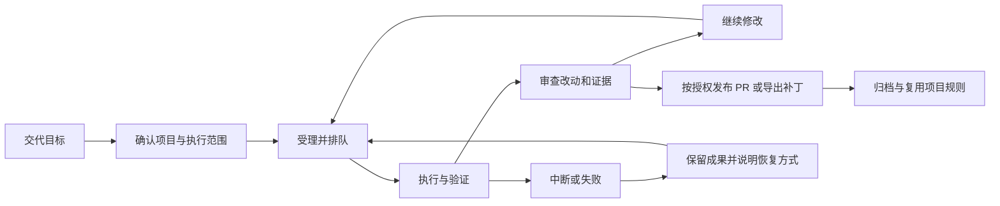

# cpx 产品演进提案

状态：产品设计提案，供后续取舍与拆解；本文不代表功能已经实现或开发已经排期。整理日期：2026-10-23，代码基线：`d2f7c9a`。

本文回答 cpx 下一步为谁解决什么问题、优先做什么、怎样判断做对了。当前产品事实以 [产品说明](PRODUCT.md)、[系统规格](specs/agent-system.md)、[系统架构](../ARCHITECTURE.md) 和代码为准。本文中的需求、指标与阶段均为建议；只有明确负责人、范围和验收条件后，才进入执行计划。

## 1. 产品主张

建议把 cpx 继续发展为：**个人开发者和小团队可以长期托付任务的自托管 AI 开发工作站。**

用户从浏览器、飞书或钉钉交代开发目标，cpx 负责保留上下文、管理执行、展示改动与验证证据，并把可审查的结果交回用户。NAS 是优先支持的常驻载体，开发机和普通服务器沿用相同的产品语义。

下一阶段最值得交付的承诺是：

> 我离开电脑后可以放心交代一个任务；回来时能知道它改了什么、验证了什么、卡在哪里。服务更新或重启后，任务记录和已有成果仍然找得到。

“持续运行”和“可远程调用”已经有基础。后续产品价值应集中在可靠执行、可核验交付和低维护成本上。模型选择、聊天平台、Skill 和 MCP 为这条主流程服务。

## 2. 现状与产品缺口

### 2.1 已经可以复用的基础

| 能力 | 当前事实 | 对演进的意义 |
| --- | --- | --- |
| 多入口 | Web 控制台、飞书 WebSocket、钉钉 Stream、HTTP 调试入口 | 手机提交与浏览器检查已经有通路 |
| 自然语言协调 | 无任务时由只读协调 Codex 查询仓库并创建任务 | 不必要求用户掌握固定命令 |
| 开发工作区 | 完整仓库缓存、每任务独立 Git worktree | 可继续建设任务隔离、成果保存与资源管理 |
| 多轮开发 | 同一工作区和 Codex `thread_id` 持续追加要求 | 已具备围绕一个目标反复修改的基础 |
| PR 流程 | 聊天开发任务默认发布 PR；后续轮次更新原分支和 PR | 已经能把开发结果送回 GitHub |
| 模型配置 | Codex 登录、账号模型目录、多套配置与有序回退 | 可以在现有配置上增加运行记录与预算控制 |
| 安装运维 | npm CLI、Dockerfile、Compose、极空间图形化部署说明 | 下一步应改善升级恢复与故障定位 |
| 扩展与审计 | Skill、MCP、命令权限确认及 SQLite 审计 | 有基础，但还需要统一任务级控制 |

事实来源：[README](../README.md)、[任务管理器](../src/agents/AgentTaskManager.ts)、[Web 控制台](../src/web/WebConsole.ts)、[消息编排](../src/core/AgentSystem.ts)。

### 2.2 已确认的缺口

| 缺口 | 当前行为及证据 | 用户受到的影响 |
| --- | --- | --- |
| 任务记录不持久 | 任务、轮次、日志、归属和协调会话保存在内存；重启不恢复 | 工作区仍在磁盘，用户却无法从任务列表接回工作 |
| 没有持久队列与容量调度 | 创建后通过微任务立即执行；已有仓库缓存锁不等于任务调度 | 多人或多任务提交时，资源与等待时间难以预期 |
| 管理入口缺少认证 | `/command` 与 `/api/console/*` 没有通用认证 | 控制台访问权实际包含代码执行和凭据管理权 |
| 权限与审计入口不一致 | Web 任务不经过聊天命令权限管理器与命令审计 | 管理员难以用同一套规则解释不同入口的行为 |
| 结果主要依赖回复与日志 | 页面以会话和运行详情为主，没有专门的 diff 与验证证据工作流 | 用户要跳转或自行查找，才能判断结果是否可采用 |
| 执行完成和交付完成混合 | Agent 运行后可直接进入提交、推送和 PR 创建 | 发布失败可能把已经完成的修改一起呈现为任务失败 |
| 本地成果缺少管理入口 | Web 工作台不提供 PR 发布入口，工作区文件继续留在磁盘 | Web 用户缺少完整的审查、发布、归档流程 |
| 扩展没有强隔离 | Skill 在主进程加载；worktree 与 CLI 参数不构成操作系统隔离 | 不能把它作为不可信代码或不可信插件的安全执行平台 |

事实来源：[任务管理器](../src/agents/AgentTaskManager.ts)、[前端任务界面](../public/app.js)、[当前安全边界](SECURITY.md)、[数据库迁移](../src/storage/migrations.ts)。数据库中存在 `tasks`、`agents` 表，并不意味着已实现 Coding Agent 任务恢复或远程执行。

### 2.3 需要验证的判断

以下是产品假设，尚没有用户访谈或使用统计证明：

- 用户最在意的是离开电脑后任务是否可靠完成，以及是否容易检查结果。
- NAS 用户愿意用有限并发换取稳定运行、简单升级和较低维护成本。
- 小团队会需要共享项目规则，但短期未必需要复杂组织管理。
- 在可信任务闭环形成之前，新增模型供应商或更多聊天平台带来的价值较小。

本文基于仓库事实推导建议，没有进行市场规模、竞品功能或定价调研。后续取舍应通过真实使用验证这些假设。

## 3. 用户与范围

### 3.1 用户优先级

| 用户 | 典型工作 | 核心诉求 | 优先级 |
| --- | --- | --- | --- |
| 有个人项目的开发者 | 通勤时交代修复，晚上检查结果 | 随时提交、连续修改、结果可追踪 | 第一优先 |
| 使用 NAS 的自托管用户 | 让设备常驻运行开发任务 | 不依赖 NAS 终端、易恢复、可控制资源 | 第一优先 |
| 数人技术团队 | 分担小需求、维护和代码检查 | 项目规则统一、任务归属清晰、人工审查 | 第二优先 |
| 工具维护者 | 接入内部系统或重复工作 | 受控扩展、明确输入输出与权限 | 主流程稳定后扩展 |

这些用户可能重合。第一阶段以“一个实例、一位管理员、若干经过授权的聊天用户”为设计规模；暂不承诺用户之间的强执行隔离。

### 3.2 最值得反复使用的任务

1. 有明确复现步骤和验收条件的小型缺陷修复。
2. 边界清晰的功能改动，例如表单校验、接口参数或移动端布局。
3. 文档维护、补充有意义的测试、局部重构。
4. 故障调查或代码解释，产出报告而不修改仓库。
5. 通过审查后的周期性维护，例如依赖检查与变更建议。

跨多个仓库的大型迁移、生产数据库修改、直接上线服务等任务，超出首个演进阶段的交付范围。

### 3.3 暂不投入的方向

- 通用聊天助手、办公套件或可视化低代码平台。
- 插件交易市场、公开多租户 SaaS 和复杂企业组织体系。
- Kubernetes 调度、跨区域高可用和大规模执行集群。
- 默认自动合并 PR 或自动部署生产环境。
- 为展示协作而引入多 Agent；先验证单任务是否确实受益于并行分工。
- 大量新增模型适配器；先把现有 Codex 的运行、恢复和成果管理做好。

## 4. 产品闭环与成功标准

### 4.1 用户旅程

这里的“确认范围”可以来自项目已保存的策略和用户本次明确指令，不要求每个任务都额外点击批准。高风险动作、授权范围变化和无法判断的恢复才需要单独决策。

### 4.2 核心指标

建议以“每周被用户接受的有效交付数”为主指标：任务产生符合验收条件的代码或报告，并由用户标记采用；PR 任务可以引用合并状态作为证据，但不能仅凭进程退出或 PR 创建就算成功。一个任务多轮修改只计一次有效交付。

| 指标 | 建议口径 | 用途 |
| --- | --- | --- |
| 首次成功时间 | 配置完成至首个任务被接受的时长 | 检查上手阻力 |
| 有效交付率 | 被接受的任务 / 已结束的有效任务；排除演示和连通性测试 | 判断是否解决真实问题 |
| 受理可靠性 | 已返回受理成功且能重新查询的任务 / 全部受理成功任务 | 检查持久化承诺 |
| 恢复成功率 | 发生中断且可继续的任务中，恢复后完成的比例 | 检查长期运行价值 |
| 审查成本 | 结果就绪至用户首次采用或明确反馈的时长与修改轮数 | 判断结果是否容易理解 |
| 运行成本 | 排队时长、执行时长、回退次数及可获得的用量 | 识别资源瓶颈 |
| 维护成本 | 用户完成一次升级或恢复所需步骤与人工介入次数 | 检查 NAS 体验 |

当前没有这些指标的测量基线。建议先在实例本地统计，不默认上传遥测；用量缺失时显示“未知”，不能以估算费用冒充账单。

首轮验证建议记录至少 20 个真实任务，覆盖修复、功能和文档场景，再决定是否扩展自动化。此样本只用于发现问题，不用于宣称统计显著性。

## 5. 需求优先级

P0 表示可信任务闭环的必要条件；P1 表示提高复用与长期运行效率；P2 表示需要先验证收益的扩展。以下排序是建议，不是已排期计划。

| 编号 | 能力 | 优先级 | 用户收益 | 相对规模与主要依赖 |
| --- | --- | --- | --- | --- |
| F01 | 管理入口认证与统一任务授权 | P0 | 明确谁能运行、查看和发布 | 中到大；涉及所有入口 |
| F02 | 任务持久化、队列和中断恢复 | P0 | 更新或重启后成果可接回 | 大；依赖持久身份和任务模型 |
| F03 | 改动审查、验证证据与独立发布 | P0 | 判断成果是否可用，发布失败可单独处理 | 大；依赖 F01、F02 |
| F04 | 项目档案与版本化执行规则 | P1 | 少重复解释项目和验收方式 | 中；复用 F01、F03 |
| F05 | 聊天与 Web 的授权任务接续 | P1 | 手机交代、浏览器审查 | 中；依赖身份绑定和持久归属 |
| F06 | 容量、预算和工作区生命周期 | P1，部分前置 | 长期运行不拖垮 NAS | 中；并发上限与磁盘检查随 F02 交付 |
| F07 | 首次引导、诊断、备份和升级 | P1，部分前置 | 日常维护可通过图形界面完成 | 中；认证初始化和恢复备份随 P0 交付 |
| F08 | 受控模板与定时维护 | P2 | 重复维护减少人工交代 | 中到大；依赖 F01—F07 的基础能力 |
| F09 | Skill/MCP 管理与执行隔离 | P2 | 扩展能力更可控 | 大；明确可信插件与隔离执行的区别 |
| F10 | 小团队共享与细分权限 | P2 | 多人共享项目而保持责任边界 | 大；依赖稳定身份与任务授权 |
| F11 | 远程执行器和可选并行协作 | P2 | 把重任务交给有足够资源的机器 | 大；依赖稳定队列、协议与隔离 |

规模为基于现有代码边界的相对判断，没有换算成人天。P0 的产出应先覆盖少量完整场景，避免一次实现整个表格。

## 6. P0：可信任务闭环

### 6.1 F01：入口认证与任务授权

**用户故事**：作为实例管理员，我能控制哪些人访问控制台、哪些聊天用户可以创建任务，并在所有入口获得一致的操作记录。

建议首版采用单管理员登录和显式聊天用户允许列表。多账号角色管理留到 F10；聊天用户仍有独立任务归属，不能因为使用同一个机器人就读取别人的任务。

具体要求：

- 首次部署通过一次性初始化凭据认领实例；凭据由运行环境生成或由管理员通过 Compose 界面预设，不能允许任意网络访问者抢先创建管理员。后续设计需给出准确的图形化操作步骤。
- 页面、任务与配置 API 统一检查会话；自动化客户端使用可撤销的独立访问令牌。登录失败限流，退出使会话失效，敏感操作保护跨站请求，认证信息不进入日志。
- `/command` 默认关闭或要求管理员令牌；其中自报的 `userId`、`source` 只能作为调试参数，不能成为可伪造的授权身份。
- 飞书、钉钉身份取自经过平台 SDK 验证的事件；用户与会话授权由服务端检查。是否允许群内使用与谁能启动开发任务应可单独配置。
- Web、聊天、内部平台工具调用共享任务授权规则，覆盖查询、续写、停止、审查、导出、发布和归档。不能只在页面上隐藏按钮。
- 记录任务发起者、入口、项目、动作、授权结果和关联轮次；登录、凭据变更、发布及工作区删除应可追踪。展示时隐藏密钥和敏感配置。
- 平台工具范围 Token 与管理员会话分开；恢复任务后重新签发，不能把短期 Token 写进任务记录用于复用。

首版验收：

1. 未登录访问任务与配置 API 被拒绝，`/health` 只返回最小存活信息。
2. 未获管理员或任务授权的用户甲，不能通过猜任务 ID 或直接调用 API 查看、续写、取消或导出用户乙的任务。
3. 同一禁止操作从 Web、聊天和工具入口调用都被拒绝，并留下关联审计。
4. 已撤销令牌或已退出会话不能继续执行操作；重启后不恢复过期授权。

这只定义应用层权限。共享宿主凭据、进程环境和任意代码执行的隔离问题仍需单独解决，不能据此宣布支持互不信任的租户。

### 6.2 F02：可靠任务运行与恢复

**用户故事**：作为常驻实例用户，我重启或更新 cpx 后仍能找到任务、轮次、已有改动和下一步恢复方式。

建议明确区分三个对象：

| 对象 | 含义 | 应保留的信息 |
| --- | --- | --- |
| 任务 | 用户的一个持续目标 | 归属、项目、基础提交、工作区、交付策略、当前结果 |
| 轮次 | 用户的一次输入及其处理结果 | 输入、回复、状态、验证与改动摘要 |
| 执行尝试 | 一轮中的一次实际运行 | 模型配置快照、开始结束、错误、用量与恢复原因 |

任务创建事务提交成功后才能返回受理成功。任务、轮次、状态变化、原始平台关联标识和必要恢复信息必须持久化；日志可分批保存，但应说明保留策略与截断范围。凭据保存引用，不把 Token 或 CLI 登录文件复制进任务表。

建议以“当前轮次状态”作为主要运行状态：

| 状态 | 用户含义 | 允许的主要动作 |
| --- | --- | --- |
| 排队中 | 已保存，等待执行容量 | 查看、取消 |
| 准备中 | 同步仓库，准备或检查工作区 | 查看、取消 |
| 执行中 | Agent 正在修改或分析 | 查看、停止；新输入可保存为待处理消息 |
| 验证中 | 执行项目配置的检查 | 查看、停止 |
| 待审查 | 本轮成果就绪，等待用户检查 | 审查、续写、按策略发布、标记采用 |
| 已完成 | 本轮目标已结束，成果与证据可查看 | 续写、导出、归档 |
| 失败 | 本轮未完成，保留已有成果与原因 | 修正条件后重试、续写、导出 |
| 已中断 | 服务或执行器中断，实际进展需核对 | 检查后恢复、保留或取消 |
| 已取消 | 用户停止本轮，已有改动仍保存 | 查看、导出；明确操作后开启新轮 |

任务可以在一个已结束轮次后追加新轮；已归档任务默认只读。发布使用独立状态，见 F03，避免让任务运行状态承载所有含义。

调度与恢复要求：

- 默认全局执行并发为 1，管理员可以调整；同一任务最多一个活动轮次。同仓库缓存更新继续串行，不把整个仓库的不同 worktree 一律串行。
- 创建与续写支持幂等键；平台重投不能重复建任务。跨重启保存去重记录，并明确有效期。
- 运行中收到追加要求时，明确显示“待处理”，允许撤回；在本轮结束后再执行，不偷偷把输入注入正在运行的进程。
- 正常关闭先停止受理新执行，按超时策略等待或中断；进程异常退出后，原活动轮次标记为“已中断”，不能假装仍在运行或自动宣告成功。
- 恢复前核对分支、HEAD、工作区改动、远端状态和 Codex 会话可用性。不能假定保存了 `thread_id` 就一定能恢复 CLI 会话。
- 首版只自动恢复尚未开始的排队任务。已开始执行的任务先由用户选择继续，避免重放外部写操作；未来可针对经验证的步骤增加自动恢复。
- 会话不可用但工作区完好时，允许以历史摘要开启新会话，明确告知上下文已重建。工作区丢失时提供失败原因和重建选项，不覆盖残留文件。
- 发布中的中断先对账远端分支与 PR，再重试；通知失败单独重试，不能因此重新运行 Agent。
- 持久化通知待发送记录；重启后重新建立平台路由。平台临时回复地址可能失效，届时显示投递失败并提供受授权的重新投递方式。

通知采用至少一次尝试投递；对支持幂等的接口使用幂等键，对不支持的接口尽量去重并标识任务与事件 ID。不能承诺跨平台绝对只送达一次。

首版验收：

1. 创建成功后立刻强制重启，任务仍可查，归属和用户输入完整。
2. 运行中重启，任务显示中断，未提交改动仍可审查；确认继续后复用正确工作区。
3. 重复提交同一平台事件只创建一个任务；重复续写请求只增加一轮。
4. 设置并发为 1 后提交三个任务，只运行一个，其余显示排队；取消排队任务不会启动子进程。
5. PR 已创建但本地记录尚未更新时中断，恢复对账后关联同一个 PR。
6. 通知发送失败不会改变开发成果状态，也不会触发第二次代码修改。

### 6.3 F03：成果审查与可控发布

**用户故事**：作为任务发起者，我能检查实际改动与验证结果，决定继续修改、发布 PR 或导出成果；发布异常不会丢掉已完成的开发结果。

结果页建议包括：

- 目标与验收条件，以及本轮满足、未满足或无法验证的项目。
- 修改文件列表、增删统计、文件 diff，明确显示新文件、删除和未跟踪文件；二进制与超大文件显示摘要和限制说明。
- 相对任务基础提交的整体变更，以及本轮前后变更；避免只看工作区未提交 diff 而漏掉 Agent 已提交的代码。
- 验证命令、实际退出码、运行时间、执行环境和脱敏后的输出引用。没有执行就显示“未运行”，Agent 自述通过只能作为说明。
- 工作区分支、基础提交、当前提交、PR 链接及发布状态。
- 继续修改、标记采用、导出补丁、发布或更新 PR、归档等有权限约束的动作。

验证命令来自经过管理员认可的项目配置，并带超时与资源限制。仓库中的命令和测试本身也能执行代码；引入可配置验证流程不等于获得安全沙箱。

发布策略建议：

| 策略 | 行为 | 适合场景 |
| --- | --- | --- |
| 仅保留成果 | 执行结束后保存工作区，用户可审查和导出 | 探索、调查、不便推送的项目 |
| 审查后发布 | 用户查看结果后授权发布指定成果版本 | 新用户、关键仓库 |
| 按预授权发布 | 在用户明确授权的仓库、分支和条件内自动发布或更新 PR | 可信项目的重复小任务 |

新安装建议以“审查后发布”为默认。现有聊天任务默认创建 PR；升级时必须说明差异并让管理员选择迁移策略，不得静默改变既有任务的授权，也不得把旧配置直接解释为更广泛的预授权。

“审查后发布”应在执行层阻止 Agent 提前推送：开发阶段不提供可推送的凭据或通道，发布由独立服务步骤在授权后执行。现有 Git hook 和提示词不能单独提供这一保证；在权限边界落地前，不得声称该模式能够强制禁止推送。

授权绑定任务、轮次、目标仓库、目标分支与成果快照；工作区在授权后发生变化，需重新核验授权。通过具体 Git 快照或等价机制避免检查时和发布时内容不一致。发现并发修改时拒绝发布并保留成果，不覆盖用户更改。

发布状态单独显示为“未请求、待授权、发布中、已发布、发布失败、待核对”。没有文件变化的分析任务可以正常完成，无需为制造交付物而创建空 PR。

首版验收：

1. 页面 diff 能覆盖未提交与已提交的任务改动，并对应明确的基础版本。
2. 测试退出非零时保留成果，显示失败证据，不因 Agent 最终回复而显示通过。
3. 发布失败后可以只重试发布，不重跑开发；重复点击不产生重复 PR。
4. 授权后成果发生变化，旧授权不能发布新成果；任何模式都不能直接推送受保护分支。
5. Web 与聊天任务使用相同发布策略和授权规则，平台差异只影响呈现方式。
6. 用户仅需本地成果时，可导出文本补丁和结果摘要；二进制或补丁无法表达的内容明确提示，不假称导出完整。

## 7. P1：把重复开发变得省心

### 7.1 F04：项目档案与上下文

把仓库从每次任务的一个输入参数，提升为可以保存规则的项目对象：默认基础分支、认可的验证命令、模型方案、执行预算、发布策略、上下文文件与保留期限。

上下文优先采用仓库已有的 `AGENTS.md`、README 和产品文档，保存来源与版本。项目可补充部署约束等长期规则；明确区分管理员执行策略、项目背景和用户本轮目标，发生冲突时解释阻塞原因，不能由模型静默决定放宽权限。

项目规则每次修改产生版本；任务保存生效版本和基础提交，后续修改默认只影响新轮次。模型总结出的“项目记忆”先作为待采纳建议，由用户确认后写入，避免错误经验逐轮固化。

验收重点：新任务能复用项目规则；历史任务能解释当时采用的版本；撤回一条错误记忆不改写历史记录；仓库文本不能自行修改实例权限或获得新密钥。

### 7.2 F05：跨入口连续使用

手机负责交代目标、查询进度和给出简短反馈；Web 负责查看 diff、配置规则和处理复杂异常。两者指向同一个经过授权的任务。

- 消息至少显示任务短 ID、项目、阶段和结果摘要；可以提供任务详情链接，但不在链接中携带长期凭据。
- 深链接只负责定位，访问仍需要登录和任务授权；NAS 地址不可达时保留可读摘要与 PR 链接，不依赖公网入口。
- Web 管理员可以管理实例任务；普通聊天用户只看到自己的任务。后续开放个人 Web 账号时，通过双端确认绑定身份，不能按显示名或邮箱猜测关联。
- 飞书与钉钉身份不自动互认；跨平台接续需要显式身份绑定和任务授权。
- 原会话仍是默认结果回传目标；切换通知目标必须由用户明确操作，并重新验证目标访问权。
- 先做好文本状态与结果，卡片更新、按钮等富交互再按平台支持情况增补。

验收重点：飞书创建的任务可由有权限的 Web 用户打开并继续处理；他人拿到链接不能查看；身份解绑后新请求失效，历史审计保留原身份。

### 7.3 F06：资源、预算与清理

为单机长期运行提供可理解的上限：执行并发、排队长度、单轮时限、模型尝试次数、日志保留量、工作区保留天数和磁盘低水位。并发限制与磁盘预检属于 F02 的首版条件。

模型额度或鉴权错误延续现有有序回退；普通代码错误不应无条件切换模型。每次尝试记录原因与实际模型，重试有上限。用量由执行事件提供时才展示；首版以执行时长和尝试次数作为可靠预算手段，不能承诺精确费用熔断。

工作区先归档再清理。清理前展示对象、大小、是否存在未提交或未推送成果、关联 PR 与恢复方式；默认不删除唯一未交付成果，不清理运行中任务，不按用户提供的任意路径删除。仓库缓存作为另一类资源单独管理。

停止任务应终止受管理的进程树，并报告是否已确认停止；停止不回滚已经发生的外部写入。无法确认进程停止时显示异常，阻止同工作区启动冲突执行。

验收重点：容量不足时任务停在队列并给出原因；磁盘不足不继续克隆；超过时限的任务保留成果；清理预览与最终删除对象一致。

### 7.4 F07：图形化上手与可恢复运维

首次引导按“认领实例 → 连接 Codex → 连接 GitHub → 选择可选消息平台 → 跑通示例任务”组织。清楚区分模型连通性测试与真正的仓库开发任务，避免用户把一次回复误认为整条链路就绪。

状态页按问题来源展示：服务、Codex 认证、GitHub 权限、消息连接、执行队列、磁盘与出站网络。每项提供脱敏错误、最近成功时间和下一步操作；代理问题要区分镜像构建阶段与容器运行阶段。

极空间体验必须遵守以下产品约束：

- 部署、更新、备份和故障查看均能通过文件管理器、Compose 图形界面、容器详情和日志完成，不依赖 NAS 终端。
- 镜像构建、导出或部署材料整理所需命令只在开发机执行，文档逐处注明执行位置。
- 镜像具有可识别版本；升级前展示兼容性、备份范围与停止任务提示，不把“覆盖程序文件”当作完整的数据升级方案。
- P0 数据持久化交付时同步提供备份和恢复路径，不能先让用户依赖数据库再补救恢复能力。

备份分层：任务与审计数据库、配置、成果工作区为核心；仓库缓存通常可重建；Codex 凭据和代理配置属于敏感材料，单独选择并说明保护方式。在线数据库必须使用一致性快照机制，或在 Compose 停止服务后通过文件管理器复制完整数据；不能运行中只复制一个 SQLite 文件而忽略其一致性。

恢复不仅检查文件存在，还要验证任务可查询、工作区可关联、权限正确和登录状态。诊断包默认不含凭据、源码和完整 prompt，用户预览后再导出。

验收重点：首次使用者可以按文档完成一个真实任务；完成一次图形化备份与恢复后能继续任务；升级失败能够恢复匹配版本的程序和数据。涉及不兼容迁移时，不得承诺只换旧镜像就能回滚。

## 8. P2：验证后再扩展

### 8.1 F08：受控自动化

先提供有限模板，例如“调查 Issue 并给出方案”“根据明确验收修复问题”“检查依赖并生成维护建议”。模板保存输入、允许动作、验证和交付策略；复制到任务后可以查看实际生效内容。

再考虑定时执行：明确时区、暂停、错过执行的处理、同项目防重入、触发历史与预算。首版建议不补跑停机期间所有时点，避免恢复后任务堆积。默认产出报告或待审查成果；不能把一次手工发布授权长期沿用到未来任务。

进入条件：持久队列和恢复稳定，维护场景确有重复使用。验收需覆盖断网、重启、重复触发和已撤销项目权限，确保一个逻辑触发不会重复产生开发成果。

### 8.2 F09：扩展管理

短期补齐 Skill 安装、卸载与 MCP 管理入口，显示来源、版本、连接状态、声明能力和实际执行边界。把适合代码任务使用的扩展显式绑定到项目；外部写操作仍受统一授权约束。

后续将 Skill 移到受管理子进程，按需探索容器执行、文件访问和出站网络限制。子进程只解决部分故障隔离问题，不自动构成安全沙箱；隔离执行成为产品承诺前必须验证越界行为。

进入条件：已有主流程无法满足的具体扩展场景和维护者。优先提供少量可验证连接器，不启动插件市场。安装任意包应明确属于管理员操作。

### 8.3 F10：小团队协作

在真实多人使用基础上，再引入管理员、项目维护者、任务发起者、审查者等角色，支持项目成员、共享队列和审查归属。

应用层身份与执行身份要分开呈现：谁发起任务、谁批准发布、实际使用哪个 GitHub 凭据、由哪个执行器运行，都要可追踪。使用共享 Token 不能宣称实现了每人的 GitHub 权限隔离。

进入条件：已有身份绑定、项目访问控制和可用隔离方案。需要互不信任成员的场景，应先解决独立凭据与执行隔离，再开放共享实例。

### 8.4 F11：远程执行与可选协作

当实测显示 NAS 性能限制任务，或任务必须访问开发机资源时，再增加远程执行器。NAS 保留控制、排队和记录，开发机负责执行。

远程执行器主动出站连接，具备显式配对、撤销、能力声明、任务租约、心跳和产物校验。凭据按任务最小范围下发；失联后先确认旧执行是否仍活动，避免同一任务被双重执行。

多 Agent 协作可作为受控实验：例如实现与独立审查分开，但必须比较交付率、耗时、用量与冲突成本。没有证据表明收益大于复杂度前，保持单 Agent 默认流程。

进入条件：单机队列和任务协议稳定，存在可复现的性能瓶颈或独立执行需求；不因“多 Agent”本身增加架构层次。

## 9. 信息架构与交互建议

建议围绕任务安排页面，保留现有会话式工作台，逐步增加成果与状态信息：

| 页面 | 主要内容 | 关键动作 |
| --- | --- | --- |
| 任务 | 按项目、归属、状态筛选的列表与连续会话 | 创建、查看、继续、停止 |
| 任务成果 | 改动、验证、未解决项、发布记录 | 审查、反馈、采用、发布、导出 |
| 项目 | 仓库、上下文、策略、验证与保留规则 | 保存规则版本、创建任务 |
| 运行状态 | 队列、容量、磁盘、连接与故障 | 调整上限、处理阻塞、查看诊断 |
| 设置 | 管理员、模型、GitHub、消息平台和扩展 | 连接、授权、撤销、备份 |

P0 可以在现有任务页内增加“会话 / 改动 / 验证 / 运行记录”，不必一次重做全部导航。手机端优先显示当前状态、主要结果和下一步操作，长日志默认折叠。

消息表达必须能指导下一步：

| 情况 | 建议反馈 |
| --- | --- |
| 排队 | “任务已保存，前方还有 2 个任务；当前同时执行上限为 1。” |
| 验证失败 | “修改已保留，接口测试失败。可查看失败输出或继续修复。” |
| 发布失败 | “开发结果已就绪，GitHub 推送被拒绝。更新权限后可只重试发布。” |
| 重启恢复 | “上轮因服务重启中断，已找到原工作区。检查改动后可继续。” |
| 路由失效 | “成果已保存，原聊天会话无法投递。可在任务页查看或重新授权通知目标。” |

这些是目标交互示例，当前版本尚未具备对应的完整状态与操作。

## 10. 数据、架构与迁移边界

这一阶段建议继续采用单机 Node.js 与 SQLite，不为候选方向提前引入 Redis、消息集群或分布式数据库。

产品需求对实现提出的边界：

1. 业务任务服务统一管理授权、状态和审计，各入口只转换输入与呈现结果。
2. 调度器负责何时运行，执行适配器负责运行，发布服务负责对外提交；恢复可以分别处理。
3. 持久化模型覆盖任务、轮次、尝试、归属、项目规则版本、成果引用和通知。日志采用有界存储与分页，不要求全量进入任务快照。
4. 大文件与源码产物保存到受管理目录，数据库保存索引与校验信息；导出、下载和清理都校验访问权与路径。
5. 状态变更与待通知事件保持一致；外部 GitHub 操作通过幂等检查和对账恢复，不假装能与 SQLite 形成一个原子事务。
6. 新旧实例不能同时操作同一工作区；升级流程检查版本与迁移状态，失败时阻止继续受理写任务。

现有 `tasks` 表并非当前内存任务对象的完整持久化实现，不能直接把对象序列化塞进去就宣称恢复完成。具体表设计应在实现阶段按查询、迁移和一致性需求确定；本文不预建数据库字段模板。

迁移必须承认旧版本没有完整历史任务记录：

- 升级前结束或保存当前工作，按部署文档停止服务并备份。
- 保留旧仓库缓存和工作区；可扫描并展示可识别的遗留工作区，供管理员核对和导入。
- 不从目录名推测可靠归属，也不虚构丢失的 prompt、日志、授权和验证记录。
- 有状态迁移引入明确版本和恢复路径；回滚使用与旧程序匹配的数据备份。
- 改动数据库时以迁移代码为事实来源，同步 `DATABASE.md`；改动真实交互后更新规格和 README。

## 11. 建议交付顺序与阶段门槛

以下阶段用于决定先后依赖，不指定日期、开发负责人或承诺版本。本文完成的是产品提案；实施工作需要另行确认并纳入执行计划。

| 阶段 | 建议范围 | 可以演示的结果 | 进入下一阶段的门槛 |
| --- | --- | --- | --- |
| A：有边界地保存任务 | F01、F02；最小并发、磁盘预检、备份恢复 | 授权用户创建任务，重启后查询并继续 | 无越权路径；受理成功不丢记录；中断恢复可复现 |
| B：完整交付成果 | F03；Web 与聊天共享结果和发布规则 | 看 diff 与验证，修改后发布同一个 PR | 成果与授权版本一致；发布重试不重跑、不重复建 PR |
| C：稳定日常使用 | F04—F07 剩余范围 | 复用项目规则，跨入口接续，完成升级与清理 | 真实任务验证主流程；图形化升级恢复成功 |
| D：有证据地扩展 | 从 F08—F11 中选择有需求的一项 | 对应维护自动化、团队或远程执行场景 | 新方向带来可观察收益，且不破坏已有恢复与权限边界 |

建议把 A、B 作为下一轮主要产品目标。只有 A 会让任务更可靠，补上 B 才能让用户完整地检查和带走成果。项目档案、自动化和远程执行都可以在这个闭环上逐步增加。

每个实施切片都应包含文档、错误路径和升级行为。例如“持久化”切片必须演示重启后的用户操作；“发布”切片必须演示远端成功、本地中断后的对账。

## 12. 验证方法与风险

### 12.1 验证安排建议

| 验证 | 方法 | 产出与判断依据 |
| --- | --- | --- |
| 需求核实 | 邀请 3—5 位目标用户讲述最近一次远程开发与维护经历 | 记录真实任务、放弃原因、现有替代方式，不以口头兴趣等同采用 |
| 上手验证 | 用干净环境按文档完成部署、授权和一个真实任务 | 记录首次成功时间与卡点；极空间全过程通过图形界面 |
| 恢复演练 | 在排队、执行、验证、推送、PR 创建、通知阶段分别中断 | 对照 F02/F03 验收检查记录、成果与外部状态 |
| 审查验证 | 让用户在结果页判断一个通过和一个失败的任务 | 能否找到变更、验证证据与下一步，不依赖开发者解释 |
| 持续使用 | 记录至少 20 个真实任务及用户反馈 | 按失败原因决定改进，判断是否值得进入项目复用与自动化 |

数量为建议的首轮探索范围，没有现成用户样本或测试结果。自动测试应覆盖授权、状态转换、幂等和恢复；与 GitHub、Codex、消息平台的真实联调作为独立检查，不依赖纯模拟测试推断外部行为。

### 12.2 主要风险与应对

| 风险 | 后果 | 应对 |
| --- | --- | --- |
| 把进程成功当作任务成功 | 用户误以为代码可合并 | 独立验证证据与用户采用状态 |
| 重启后盲目重跑 | 重复推送、重复 PR 或重复外部写入 | 中断状态、远端对账、默认人工恢复已开始任务 |
| 有登录但执行仍共享全部权限 | 用户误解安全保证 | 说明执行身份，分离发布凭据，逐步实施强隔离 |
| 收敛状态却丢掉细节 | 发布或通知异常掩盖已完成成果 | 分离执行、成果、发布与通知记录 |
| 项目记忆错误或被仓库内容污染 | 长期任务持续偏离或越权 | 版本来源、人工采纳、权限由服务端控制 |
| 日志和工作区无限增长 | NAS 磁盘耗尽，任务受损 | 配额、预检、有保护条件的清理与备份 |
| 升级改变任务默认行为 | 用户已有授权被错误解释 | 明确迁移选择，保存策略版本和历史授权 |
| 功能扩展过快 | 主流程长期不稳定 | 以阶段门槛限制自动化、团队与远程执行投入 |

## 13. 下一轮需要确定的产品决策

建议在启动实现前集中确定以下事项；未确定项不阻碍本提案作为讨论基础：

| 决策 | 建议起点 | 为什么需要确定 |
| --- | --- | --- |
| 首要用户 | 个人开发者与 NAS 自托管用户 | 决定上手、资源和部署体验的取舍 |
| 首版身份 | 单管理员与显式授权聊天用户 | 控制身份管理规模，并明确任务归属 |
| 发布默认值 | 新安装审查后发布；旧安装显式迁移 | 与现有聊天自动 PR 行为存在差异 |
| 恢复策略 | 队列可自动恢复，已开始任务先核对再继续 | 避免重放不可逆操作 |
| 默认资源 | 执行并发为 1；其他阈值按试运行测量 | 先保证 NAS 稳定，避免凭空承诺容量 |
| 第一轮范围 | 阶段 A 与 B，先覆盖一个仓库的完整流程 | 将产品价值落到可演示的可靠交付 |
| 后续投入依据 | 真实任务的交付率、恢复问题和重复维护需求 | 用实际使用决定扩展方向 |

确认后，为选中的实施切片指定负责人、验收场景和数据迁移方案，再创建执行计划。没有被选择的方向继续作为提案候选，不提前建立空计划、空页面或空数据库结构。
